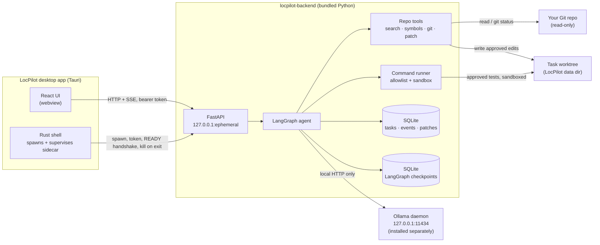
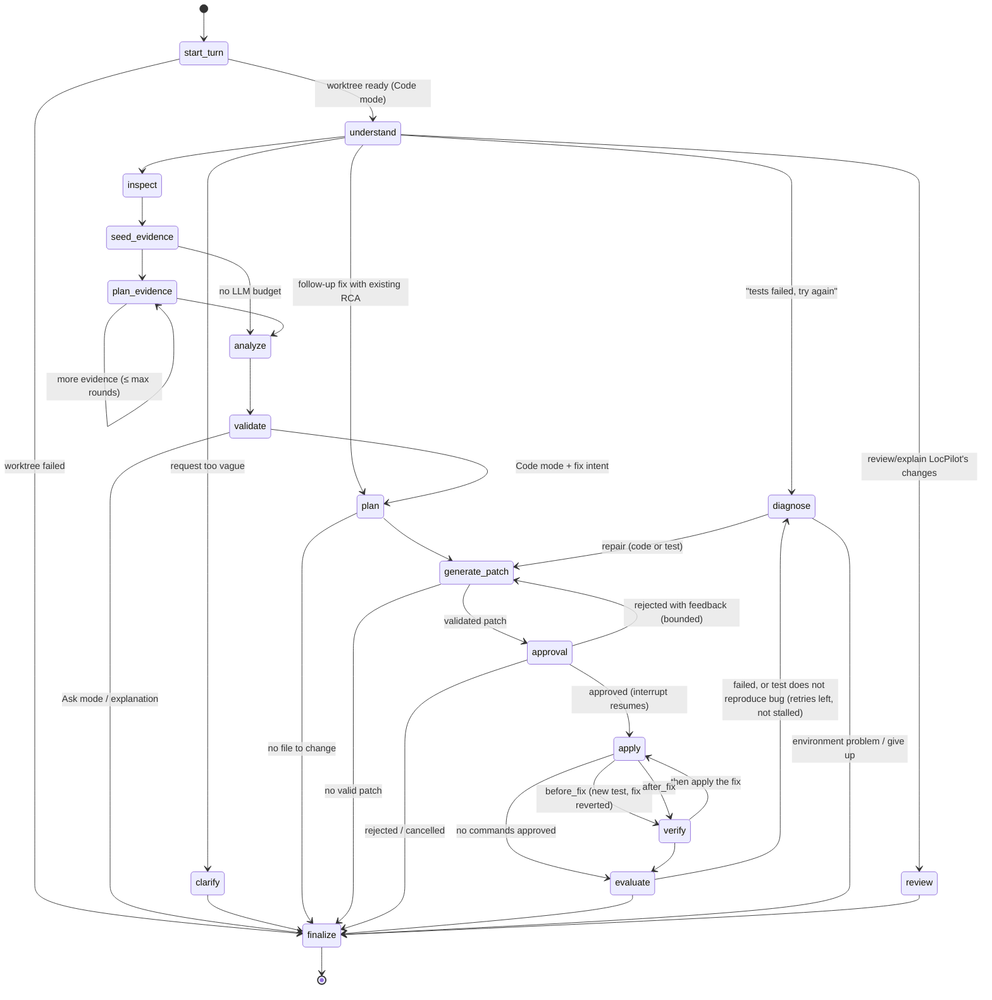
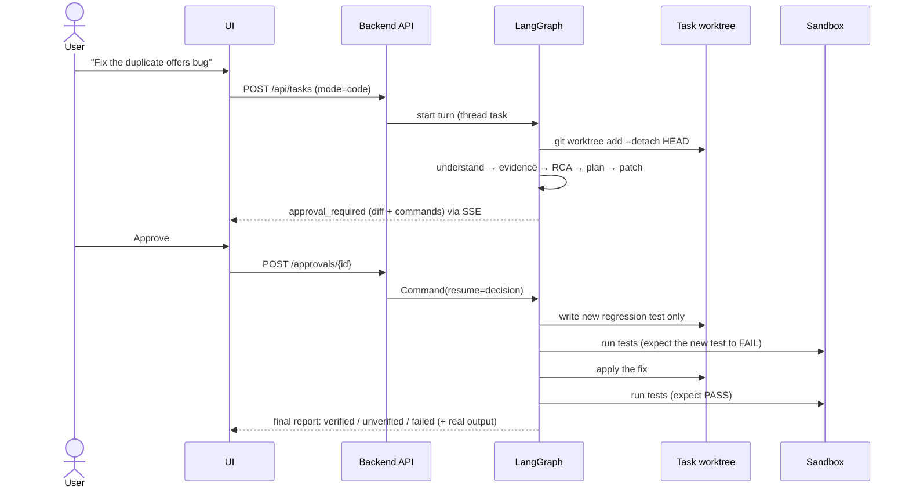

# LocPilot architecture

LocPilot is a local-first coding agent packaged as a desktop app. Everything — UI,
agent, repository tools, model inference, storage — runs on your machine. There is no
hosted backend and no cloud model fallback.

## System context

* **Tauri shell** (`frontend/src-tauri`) generates a per-launch token, starts the sidecar
  with `--port 0 --data-dir <app data> --parent-pid <pid>`, reads the
  `LOCPILOT_READY {"port":…}` line, and hands `{base_url, token}` to the UI via the
  `backend_info` command. The webview has no shell/process permissions.
* **Backend** (`backend/locpilot`) binds loopback only; every request is checked for
  Host (anti DNS-rebinding), Origin, a custom header on state-changing requests, and the
  bearer token. See [security.md](security.md).
* **Ollama** is a separate install. The setup screen detects it and the configured
  model and guides installation; the model download is an explicit user action
  performed by the local Ollama daemon.

## Backend layout

| Package | Responsibility |
|---|---|
| `locpilot/api` | HTTP routes: setup/model, repos, tasks, SSE events, approvals, diffs, rollback |
| `locpilot/agent` | LangGraph graph, prompts, schemas, evidence retrieval, citation validation, runner |
| `locpilot/tools` | File inventory, text/regex search, Tree-sitter/ast symbols, Git, manifests, patch engine, test-output parsing, subprocess runner |
| `locpilot/security` | Path confinement, secret detection/redaction, command policy, OS sandbox, HTTP hardening |
| `locpilot/storage` | SQLite application database |
| `locpilot/llm` | Ollama client (streaming, schema-constrained JSON, pull) |

## Agent state machine

One graph run handles one conversation turn. Turns use separate checkpoint threads
(`<task>#<turn>`); persistent context (report, plan, evidence, approved commands, last
test runs, history) is carried into the next turn's input.

### What each step does

| Node | Kind | Notes |
|---|---|---|
| `understand` | LLM (JSON) | intent, search terms, symbols, file hints, error strings, clarification need |
| `inspect` | deterministic | inventory (respects `.gitignore` + exclusions), Tree-sitter/ast symbol index, manifests, test frameworks |
| `seed_evidence` | deterministic | explicit paths → symbol definitions → callers → exact strings → BM25-style ranked windows → related tests |
| `plan_evidence` | LLM (JSON) + tools | up to 4 read-only tool calls per round (`search_text`, `search_regex`, `find_definition`, `find_callers`, `read_file`, `list_directory`, `find_tests`, `git_log`), ≤ `MAX_EVIDENCE_ROUNDS` rounds |
| `analyze` | LLM (JSON) | RCA: execution flow → suspicious lines → hypotheses → root cause; or explanation |
| `validate` | deterministic | every citation resolved against evidence shown and files on disk; invalid ones removed and listed; root-cause citation re-anchored to the line naming the identifier |
| `plan` | LLM (JSON) | files to change (must exist), new regression test file, allow-listed test commands |
| `generate_patch` | LLM (text) | SEARCH/REPLACE blocks → validated by LocPilot (unique match, path policy, syntax check) → difflib diff; test step designs a spec first (correct vs buggy behavior) |
| `approval` | `interrupt()` | human approves/rejects the exact diff and command list |
| `apply` | deterministic | atomic, hash-checked writes in the worktree; "before" stage applies only the new test with any fix temporarily reverted |
| `verify` | subprocess | approved commands, sandboxed, timeouts, output caps, parsed summaries |
| `evaluate` | deterministic | verdict, regression proof (fails before / passes after), pre-existing vs new failures, stall signature |
| `diagnose` | LLM (JSON) or deterministic | environment problems are detected from output and never "fixed" by code; non-reproducing tests trigger a test repair |
| `finalize` | deterministic | final report, honest status (`changes_verified` only with execution proof) |

### Bounded behavior

* LLM calls per turn ≤ `LOCPILOT_MAX_LLM_CALLS` (default 24).
* Evidence rounds ≤ `LOCPILOT_MAX_EVIDENCE_ROUNDS` (2), ≤ 4 tool calls each.
* Edit validation retries: 1 per edit step.
* Repair attempts ≤ `LOCPILOT_MAX_RETRIES` (2); identical failure signatures stop the loop.
* Patch regenerations after rejection with feedback ≤ `LOCPILOT_MAX_PATCH_ATTEMPTS` (2).
* Commands: `LOCPILOT_COMMAND_TIMEOUT_S` (300 s), output capped (head + tail) at 200 KB.

## Code mode sequence

## Persistence and recovery

* `locpilot.db`: repositories, tasks, messages, events (SSE replay), reports, commands
  (argv, exit code, stdout/stderr, duration, sandbox, parsed summary), patches (validated
  file changes incl. original content), approvals, settings.
* `checkpoints.db`: LangGraph `AsyncSqliteSaver`, written synchronously after every step
  (`durability="sync"`).
* On startup, turns that were running become `interrupted`. **Resume** continues from the
  last checkpoint. Writes are hash-checked and idempotent, so resuming never re-applies an
  edit; re-running tests is safe. Pending approvals survive restarts.

## Event stream

The UI renders the investigation timeline exclusively from backend events (see
[api.md](api.md) §4). Events are persisted with monotonically increasing ids; the SSE
endpoint replays from `after`/`Last-Event-ID` and then streams live events, so reloads and
reconnects never lose history. Token progress and live command output are ephemeral.

## Data locations

| Mode | Data directory |
|---|---|
| Browser dev mode | `~/.locpilot` (or `LOCPILOT_DATA_DIR`) |
| Desktop app | OS app-data dir passed by Tauri (macOS: `~/Library/Application Support/dev.locpilot.desktop`) |

Inside: `locpilot.db`, `checkpoints.db`, `repos/` (clones), `worktrees/<task>`,
`scratch/<task>` (sandbox temp/caches), `logs/`.
