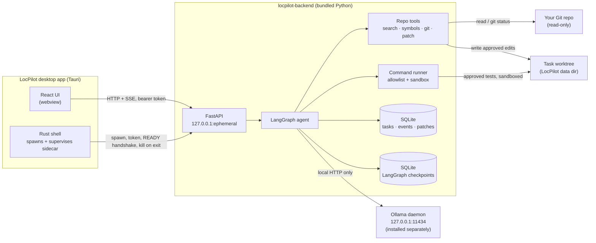
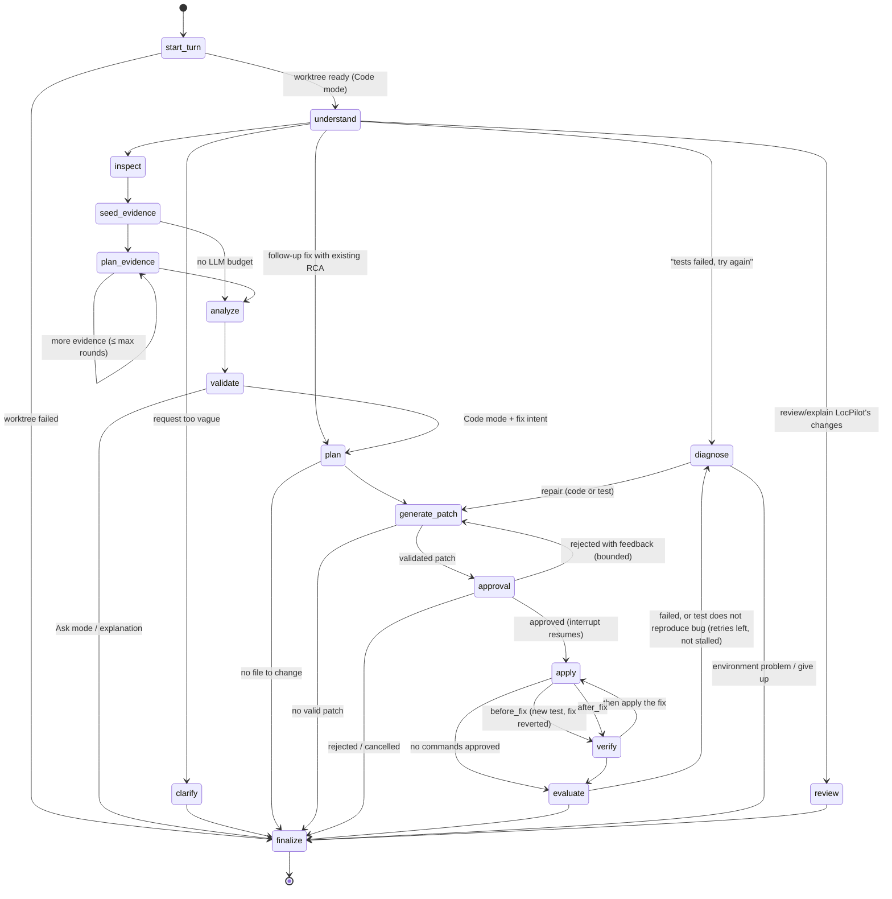
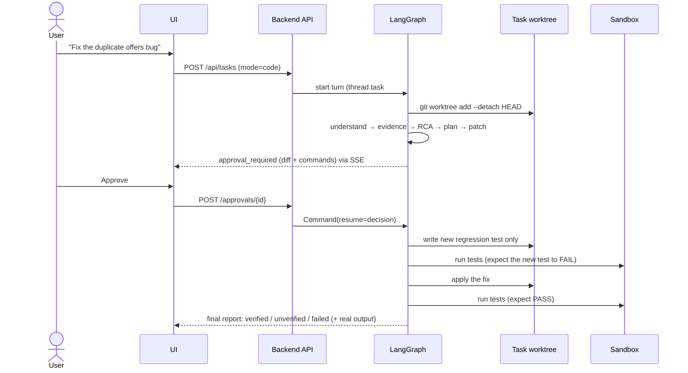

# LocPilot architecture

LocPilot is a local-first coding agent packaged as a desktop app. Everything — UI,
agent, repository tools, model inference, storage — runs on your machine. There is no
hosted backend and no cloud model fallback.

## System context

* **Tauri shell** (`frontend/src-tauri`) generates a per-launch token, starts the sidecar
  with `--port 0 --data-dir <app data> --parent-pid <pid>`, reads the
  `LOCPILOT_READY {"port":…}` line, and hands `{base_url, token}` to the UI via the
  `backend_info` command. The webview has no shell/process permissions.
* **Backend** (`backend/locpilot`) binds loopback only; every request is checked for
  Host (anti DNS-rebinding), Origin, a custom header on state-changing requests, and the
  bearer token. See [security.md](security.md).
* **Ollama** is a separate install. The setup screen detects it and the configured
  model and guides installation; the model download is an explicit user action
  performed by the local Ollama daemon.

## Backend layout

| Package | Responsibility |
|---|---|
| `locpilot/api` | HTTP routes: setup/model, repos, tasks, SSE events, approvals, diffs, rollback, your own commands, apply/commit/push, terminals |
| `locpilot/agent` | LangGraph graph, prompts, schemas, evidence retrieval, citation validation, runner |
| `locpilot/tools` | File inventory, text/regex search, Tree-sitter/ast symbols, Git (incl. commit/push/apply on your click), manifests, patch engine, test-output parsing, subprocess runner, PTY terminals |
| `locpilot/security` | Path confinement, secret detection/redaction, command policy, OS sandbox, HTTP hardening |
| `locpilot/storage` | SQLite application database |
| `locpilot/llm` | Ollama client (streaming, schema-constrained JSON, pull) |

## Agent state machine

One graph run handles one conversation turn. Turns use separate checkpoint threads
(`<task>#<turn>`); persistent context (report, plan, evidence, approved commands, last
test runs, history) is carried into the next turn's input.

### What each step does

| Node | Kind | Notes |
|---|---|---|
| `understand` | LLM (JSON) | intent, search terms, symbols, file hints, error strings, clarification need |
| `inspect` | deterministic | inventory (respects `.gitignore` + exclusions), Tree-sitter/ast symbol index (on disk; shows progress on a first large index), manifests, test frameworks |
| `seed_evidence` | deterministic | explicit paths → symbol definitions → callers → exact strings → BM25-style ranked windows → functions that code calls in other files (when their names relate to the request; also after every `plan_evidence` round) → related tests |
| `plan_evidence` | LLM + tools | **Tool-capable models** (Ollama's `tools` capability): a tool loop — the model calls `read`, `grep`, `find_definition`, `find_callers`, `list`, sees each result, and decides the next step (≤ 10 turns, within the evidence budget and the context window); whatever it looks at becomes evidence, and its closing summary is passed to the analysis as a note. Code is shown once: asked again for lines it already has, the model gets a pointer to them ("lines 60-100 are E1") instead of the same text — small models re-read a file in overlapping pieces, and every repeated line costs time and context — and two such repeats end the exploring. **Other models**: a JSON plan of up to 4 read-only tool calls per round (`search_text`, `search_regex`, `find_definition`, `find_callers`, `read_file`, `list_directory`, `find_tests`, `git_log`), ≤ `MAX_EVIDENCE_ROUNDS` rounds |
| `analyze` | LLM (JSON) | RCA: execution flow → suspicious lines → hypotheses → root cause; or explanation. The RCA prompt (and later the failure diagnosis) ends with a short reminder of the classic pitfalls of the languages in the evidence (JavaScript/TypeScript, Python — e.g. `sort()` without a compare function sorts numbers as strings): a small model reads straight past such a line, but finds it when reminded and shown a failing result |
| `validate` | deterministic | every citation resolved against evidence shown and files on disk; invalid ones removed and listed; root-cause citation re-anchored to the line naming the identifier |
| `plan` | LLM (JSON) | files to change (existing ones, or a new source file next to related files when the request needs one), new regression test file (in the test folder nearest the code), allow-listed test commands. A request classified as tests-only whose plan creates a source file ("add X, with tests") is treated as a change with tests: the code is written first |
| `generate_patch` | LLM (tools or text) | **Tool-capable models** edit through tool calls — `edit(file_path, old_string, new_string)`, `write`, plus `read`/`grep` to check the code first — in a loop of ≤ 10 turns; each edit is staged in memory and validated on top of the earlier ones, and a rejected edit tells the model why. When the code change is finished, the model **walks the request's example through its own change** (one JSON answer in the same conversation: the example, a line-by-line trace with the actual values, the result, what the request asks for). If its own trace shows a different result, it is given those two results — not its explanation of them, which only repeats the theory the change was built on — and corrects the change before anything is proposed. A tool call that runs into the reply's length limit (a long new file) is incomplete and dropped by the model server; LocPilot says so and asks for a shorter one, with the rest added by `edit`. The loop also ends when the model is evidently done but does not say so: two turns in a row of only re-reading code it has seen, or of edits that are all refused (typically a test written in the code step — the regression test has a step of its own). Nothing is written before approval. They may fix a source file the plan did not name (the patch says so). **Other models** print SEARCH/REPLACE blocks (JSON as a last resort). Either way LocPilot validates (unique match, path policy, syntax check) and computes the diff with difflib; the test step designs a spec first (correct vs buggy behavior, using every example the request gives). Before the patch is proposed, a **check against the request** (one call, fresh context): the model lists what the request requires and tries to break the changed code with concrete inputs; if a requirement does not hold, the fix and/or the test get one revision round in the conversation that wrote them (tool-capable models), and the finding is shown with the patch either way. This catches a wrong fix that a test written from the same misunderstanding would "verify" (`LOCPILOT_CHECK_CHANGES=false` turns it off) |
| `approval` | `interrupt()` | human approves/rejects the exact diff and command list |
| `apply` | deterministic | atomic, hash-checked writes in the worktree; "before" stage applies only the new test with any fix temporarily reverted |
| `verify` | subprocess | approved commands, sandboxed, timeouts, output caps, parsed summaries |
| `evaluate` | deterministic | verdict, regression proof (fails before / passes after), pre-existing vs new failures, stall signature |
| `diagnose` | LLM (JSON) or deterministic | environment problems are detected from output and never "fixed" by code; non-reproducing tests trigger a test repair. Failures are attributed first — LocPilot's own new test, existing tests that were passing, tests that were already failing — and the model decides, with the request as the authority, whether the tests or the code must change: a wrong new test is corrected instead of the fix (it must still fail without the fix); an existing test may be updated only after it has been seen failing because the request changed what it asserts (the approval says so); tests that were already failing and still fail are not written off as "already broken" when they exercise the code the request is about. Before the verdict the model has to trace the first failing assertion through the code with the actual values (how the code produces the value the test *received*): asked for a verdict straight away, a small model defends the theory its change was built on. With tools, the diagnosis and the repair continue the conversation that wrote the test or the fix |
| `finalize` | deterministic | final report, honest status (`changes_verified` only with execution proof) |

### Bounded behavior

* LLM calls per turn ≤ `LOCPILOT_MAX_LLM_CALLS` (default 60; a tool loop is several short calls).
* Tool loops: ≤ 10 turns exploring, ≤ 10 turns per edit step; they stop early when the context window is nearly
  full, when the model repeats itself, or when it only re-reads what it has already seen.
* `LOCPILOT_NATIVE_TOOLS=false` turns tool calling off (every model then uses the text protocol).
* With tools, the analysis continues the exploration conversation and the plan continues the analysis (when they
  fit the context window): the model server then only processes the new instruction instead of the whole context
  again. Hybrid models (Qwen3.5/MiMo) cannot reuse a cached prefix for a *different* prompt, so this saves about
  1.5 minutes per step on a laptop.
* Context window: `LOCPILOT_NUM_CTX` (16384) unless you set it; models whose context is cheap to hold (hybrid
  models: 32k tokens in about 1 GB) get 32768 automatically on machines with 16 GB or more.
* Evidence rounds ≤ `LOCPILOT_MAX_EVIDENCE_ROUNDS` (2), ≤ 4 tool calls each.
* Edit validation retries: 1 per edit step.
* Repair attempts ≤ `LOCPILOT_MAX_RETRIES` (2); identical failure signatures stop the loop.
* Patch regenerations after rejection with feedback ≤ `LOCPILOT_MAX_PATCH_ATTEMPTS` (2).
* Commands: `LOCPILOT_COMMAND_TIMEOUT_S` (300 s), output capped (head + tail) at 200 KB.

## Code mode sequence

## Persistence and recovery

* `locpilot.db`: repositories, tasks, messages, events (SSE replay), reports, commands
  (argv, exit code, stdout/stderr, duration, sandbox, parsed summary), patches (validated
  file changes incl. original content), approvals, settings.
* `checkpoints.db`: LangGraph `AsyncSqliteSaver`, written synchronously after every step
  (`durability="sync"`).
* On startup, turns that were running become `interrupted`. **Resume** continues from the
  last checkpoint. Writes are hash-checked and idempotent, so resuming never re-applies an
  edit; re-running tests is safe. Pending approvals survive restarts.

## Event stream

The UI renders the investigation timeline exclusively from backend events (see
[api.md](api.md) §4). Events are persisted with monotonically increasing ids; the SSE
endpoint replays from `after`/`Last-Event-ID` and then streams live events, so reloads and
reconnects never lose history. Token progress and live command output are ephemeral.

## Data locations

| Mode | Data directory |
|---|---|
| Browser dev mode | `~/.locpilot` (or `LOCPILOT_DATA_DIR`) |
| Desktop app | OS app-data dir passed by Tauri (macOS: `~/Library/Application Support/dev.locpilot.desktop`) |

Inside: `locpilot.db`, `checkpoints.db`, `repos/` (clones), `worktrees/<task>`,
`archived-worktrees/<task>.json` (worktrees archived to free space; restored on next use),
`index/symbols.sqlite` (the code index, a cache), `model-sizes.json` (the RAM each model took when
loaded, for the memory check), `scratch/<task>` (sandbox temp/caches), `logs/`.

**Code index.** Symbols (definitions, call sites, imports) are kept in `index/symbols.sqlite`, not in
memory, so a large repository costs disk rather than RAM (up to the inventory's 60,000 files). Each
file's parse is stored once per content (language + hash): task worktrees reuse the parses of the main
checkout, and after a restart only files that changed are parsed again. Folders that no longer exist
and parses nothing refers to are dropped at startup.
