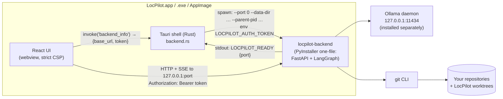

# LocPilot desktop app (Tauri + bundled Python agent)

LocPilot ships as a native desktop application:

- **Shell:** [Tauri v2](https://v2.tauri.app) (Rust) hosting the React UI in the OS webview (WKWebView on
  macOS, WebView2 on Windows, WebKitGTK on Linux).
- **Agent:** the Python FastAPI + LangGraph backend, frozen with PyInstaller into one executable
  (`locpilot-backend`) and bundled as a Tauri *sidecar*.
- **Inference:** [Ollama](https://ollama.com), installed separately by the user. Neither Ollama nor any
  model is bundled in the installer.

There is no hosted backend, no Vercel deployment, no cloud fallback and no auto-updater. After setup the
app works fully offline.

## Architecture



Startup sequence:

1. The shell generates a random 256-bit token for this launch and starts the sidecar with
   `--host 127.0.0.1 --port 0 --data-dir <app data dir> --parent-pid <shell pid>`, passing the token in
   `LOCPILOT_AUTH_TOKEN`.
2. The backend binds an ephemeral loopback port and prints exactly one line on stdout:
   `LOCPILOT_READY {"port": 51234, "pid": …, "version": "0.1.0"}`.
3. The shell parses that line and emits `backend-status` to the webview. The UI calls the
   `backend_info` command to get `{status, base_url, token, error, logs_tail}`. Until then it shows
   "Starting LocPilot's local agent…". If the backend fails or times out (120 s), the UI shows the
   error and the last log lines, with a **Retry** button (`restart_backend`).
4. The UI checks `/api/setup/status`. If Ollama, the configured model or Git is missing, the **first-run
   setup screen** appears (see below). Otherwise the main workspace opens.

Shutdown: on app exit the shell sends SIGTERM to the sidecar (the PyInstaller bootloader forwards it to
Python so running tasks and their subprocesses are stopped), waits up to 4 s, then force-kills it.
If the shell crashes, the backend notices that `--parent-pid` is gone and exits by itself within a few
seconds.

### Security boundaries of the shell

| Concern | Measure |
|---|---|
| Other local processes or web pages calling the agent | Backend binds `127.0.0.1` only, requires the per-launch bearer token, checks `Host`/`Origin`, and requires `X-LocPilot-Client` on state-changing requests (see `docs/api.md` §2). |
| Webview privileges | `capabilities/default.json` grants only `core:default`, `dialog:allow-open` (folder picker) and `opener:allow-open-url` for a few https documentation/download domains. The webview cannot spawn processes or touch the filesystem. All repository access goes through the backend's validation. |
| Remote content / XSS | Strict CSP: `default-src 'self'`, scripts only from the bundle, `connect-src` limited to `ipc:` and `http://127.0.0.1:*`, no frames or forms. Markdown from the model is rendered without raw HTML. Links never navigate the webview; `https` links open in the system browser. |
| Monaco / fonts | Bundled locally (`monaco-editor` package and its workers; system fonts), so nothing is loaded from a CDN. `@monaco-editor/react`'s default CDN path is overridden with `loader.config({ monaco })`. |
| Saving patches | `save_text_file` opens a native save dialog in Rust; the webview cannot choose a path itself. |

`style-src` allows `'unsafe-inline'` because Monaco injects styles at runtime, and
`dangerousDisableAssetCspModification: ["style-src"]` stops Tauri from adding nonces that would
otherwise disable `'unsafe-inline'`. Scripts still require `'self'`.

## First-run dependency setup

The setup screen (also reachable from **Settings → Open setup**, the wrench button in the sidebar, or the
model status pill) polls `/api/setup/status` every 3 s until everything required is ready, and has a
**Check Again** button. It shows:

- **Ollama**: reachable or not, with OS-specific install steps from the backend (download page, opened
  in the system browser, or `brew install ollama`) and how to start it.
- **Model** (default `qwen2.5-coder:7b`): installed or not. Users can copy `ollama pull <model>` or
  click **Download <model> with Ollama**, which asks the local Ollama daemon to pull the model and shows
  live progress. They can also switch to a model that is already installed.
- **Git** (required) and the **test-command sandbox** (informational).

AI features stay disabled until a local model is ready. The UI says so explicitly, and there is no
cloud fallback. Users can choose **Continue without AI (browse only)** to browse repositories and
history.

## Development

Prerequisites: Node 20.19+ (22 LTS recommended), Python 3.12 with [uv](https://docs.astral.sh/uv/),
Rust stable (`rustup`), Git, and on Linux the WebKitGTK packages listed under *Release builds*.
If rustup was installed with `--no-modify-path`, run `source "$HOME/.cargo/env"` first.

**Browser mode** (fastest UI iteration, no Rust needed): start the backend on `127.0.0.1:8420` and the
Vite dev server on `127.0.0.1:5420`. `./scripts/dev.sh` does both. Vite proxies `/api` to the backend.
If the backend was started with `LOCPILOT_AUTH_TOKEN`, set the same value in `LOCPILOT_DEV_TOKEN` for
Vite; the proxy injects the header server-side so the token never reaches browser JavaScript. Without
Tauri, the native folder picker is replaced by a path input.

```bash
cd backend && LOCPILOT_AUTH_TOKEN=dev uv run locpilot-backend --port 8420
cd frontend && LOCPILOT_DEV_TOKEN=dev npm run dev     # http://127.0.0.1:5420
```

**Desktop dev mode** (`tauri dev`):

```bash
python3 scripts/build_sidecar.py      # once, and after backend changes (Tauri requires the sidecar binary)
cd frontend && npm run tauri dev
```

To iterate on the backend without rebuilding the sidecar, debug builds can attach to an externally
started backend instead:

```bash
LOCPILOT_EXTERNAL_BACKEND=http://127.0.0.1:8420 LOCPILOT_DEV_TOKEN=dev npm run tauri dev
```

Frontend checks: `npm run typecheck && npm run lint && npm test` (Vitest + Testing Library).

## Building installers locally

```bash
scripts/build_desktop.sh                     # all bundle types for this OS
scripts/build_desktop.sh --bundles app,dmg   # macOS: just the .app and .dmg
```

This runs `scripts/build_sidecar.py`, then `npm run tauri build`. `build_sidecar.py`:

1. Runs PyInstaller (one-file) on `locpilot.main:main` through `uv run --project backend`. Build
   artifacts go to `build/sidecar/`.
2. Copies the result to `frontend/src-tauri/binaries/locpilot-backend-<target-triple>[.exe]`, which
   Tauri's `externalBin` naming expects. The triple comes from `rustc -vV`.
3. Smoke-tests the binary exactly as the shell launches it: waits for the `LOCPILOT_READY` line,
   checks `/api/health`, checks that `/api/setup/status` works with the token, and checks that it
   returns 401 without the token.

PyInstaller cannot cross-compile, so build each OS/architecture on that platform (CI does this).

Output (`frontend/src-tauri/target/release/bundle/`): macOS `macos/LocPilot.app` and
`dmg/LocPilot_<version>_<arch>.dmg`; Windows `msi/*.msi` and `nsis/*-setup.exe`; Linux
`appimage/*.AppImage`, `deb/*.deb` and `rpm/*.rpm`.

## Releasing through GitHub Releases

`.github/workflows/release.yml` runs on a pushed `v*` tag, or manually through *Run workflow* with a tag
input. It builds on four native runners: macOS arm64, macOS x64, Windows x64 and Ubuntu 22.04 x64. Each
runner builds and smoke-tests the sidecar, runs the frontend checks, and builds the bundles with
`tauri-apps/tauri-action`. The installers are attached to a **draft** release. A maintainer reviews the
draft and publishes it; nothing is published automatically.

```bash
git tag v0.1.0 && git push origin v0.1.0
```

The Linux build uses Ubuntu 22.04 on purpose, because users need at least that glibc. If GitHub retires
the `macos-15-intel` label, update the matrix.

### Code signing (optional)

Without secrets, the workflow produces **unsigned** builds. They work, but users see OS warnings.

| Platform | Secrets | Notes |
|---|---|---|
| macOS signing | `APPLE_CERTIFICATE` (base64 `.p12`), `APPLE_CERTIFICATE_PASSWORD`, `APPLE_SIGNING_IDENTITY` | Developer ID Application certificate. |
| macOS notarization | `APPLE_ID`, `APPLE_PASSWORD` (app-specific password), `APPLE_TEAM_ID` | Required for a warning-free first launch on modern macOS. |
| Windows | `WINDOWS_CERTIFICATE` (base64 `.pfx`), `WINDOWS_CERTIFICATE_PASSWORD` | The workflow imports it and writes `src-tauri/tauri.windows.conf.json` with the thumbprint. |

**macOS entitlements** (`frontend/src-tauri/entitlements.plist`) matter only for hardened-runtime
(signed and notarized) builds. The PyInstaller one-file sidecar unpacks the Python runtime and native
extension modules (`.so`/`.dylib`) into a temporary folder at startup and loads them. Those files are
not signed with your Team ID, so they need `com.apple.security.cs.disable-library-validation`. CPython
and ctypes need `com.apple.security.cs.allow-unsigned-executable-memory`. After signing, check the
sidecar inside the bundle with
`codesign -d --entitlements - LocPilot.app/Contents/MacOS/locpilot-backend`. If notarization rejects
the one-file binary, switch PyInstaller to `--onedir` and ship the folder as a Tauri `resource`.

### Opening unsigned builds

- **macOS:** the first time, Gatekeeper blocks the app. Open it once, then go to *System Settings →
  Privacy & Security* and choose **Open Anyway**. Alternatively, after copying it to Applications, run
  `xattr -dr com.apple.quarantine /Applications/LocPilot.app`. Local builds are ad-hoc signed and open
  normally on the machine that built them.
- **Windows:** SmartScreen shows "Windows protected your PC". Click **More info → Run anyway**.
- **Linux:** for the AppImage, run `chmod +x LocPilot_*.AppImage` and then start it. The `.deb`/`.rpm`
  packages depend on `git`.

## Where data lives

The shell passes its app-data directory to the backend. The bundle identifier is `dev.locpilot.desktop`.

| OS | Location |
|---|---|
| macOS | `~/Library/Application Support/dev.locpilot.desktop/` |
| Windows | `%APPDATA%\dev.locpilot.desktop\` |
| Linux | `$XDG_DATA_HOME/dev.locpilot.desktop/` (usually `~/.local/share/…`) |

Contents: `locpilot.db` (repositories, tasks, events, commands, patches), `checkpoints.db` (LangGraph
checkpoints for resuming tasks), `repos/` (clones of GitHub repositories), `worktrees/` (isolated Git
worktrees for Code-mode tasks), `scratch/`, and `logs/backend.log`. Browser dev mode defaults to
`~/.locpilot/`.

Uninstalling the app does not delete this folder. Remove it manually to erase history and clones. Your
own local repositories are never stored here.

## "Fully offline after setup"

Network access is needed only for:

1. downloading the LocPilot installer,
2. installing Ollama and pulling a model, an explicit user action performed by Ollama, and
3. cloning a repository from GitHub, an explicit user action.

Everything else runs locally and works offline: the UI (Monaco and fonts are bundled), the agent,
inference through the local Ollama at `127.0.0.1:11434`, indexing, Git operations on local repositories,
and test execution. The backend refuses non-loopback Ollama URLs unless explicitly configured. LocPilot
has no auto-updater; updates come from new installers on GitHub Releases.

## Troubleshooting

- **"The local agent failed to start"**: the error panel shows the last backend log lines. The full log
  is `logs/backend.log` in the data directory above. Common causes: the data directory is not writable,
  or an antivirus product quarantined `locpilot-backend`. Click **Retry** after fixing the cause.
- **Git or Ollama not found when launched from Finder/Dock**: GUI apps on macOS and Linux don't inherit
  your shell `PATH`. The frozen backend imports `PATH` from your login shell and adds common locations
  (`/opt/homebrew/bin`, `/usr/local/bin`). Check the setup screen to see what was detected.
- **Linux build fails on `webkit2gtk`**: install `libwebkit2gtk-4.1-dev libappindicator3-dev librsvg2-dev patchelf`.
- **Port conflicts** are not possible in the desktop app because the backend picks a free ephemeral
  port on every launch. In browser dev mode, ports 8420 and 5420 must be free.
- **Slow first screen (about 6–13 s on macOS):** the one-file sidecar unpacks itself to a temporary
  folder on every launch, and macOS scans the freshly unpacked libraries. Measured on an M4: about 1 s to
  import the login-shell `PATH`, about 1.3 s of Python imports, and the rest unpacking and scanning. A
  `--onedir` sidecar shipped as a Tauri resource would start faster but needs extra signing work for
  notarized builds; that is a possible future improvement.

## Verification status

On macOS 26 (Apple Silicon), the following was built and tested:

- `LocPilot.app` and the `.dmg` were built.
- The sidecar smoke test passed. The backend was ready in about 6.5 s on a cold start.
- The packaged app launched its sidecar, and the webview reached it with the token.
- Quitting the app stopped the sidecar, and force-killing the shell left no orphaned processes.

The following were **not** tested:

- Windows and Linux bundles.
- Signed or notarized builds.
- The GitHub Actions workflow, which has not been run.
